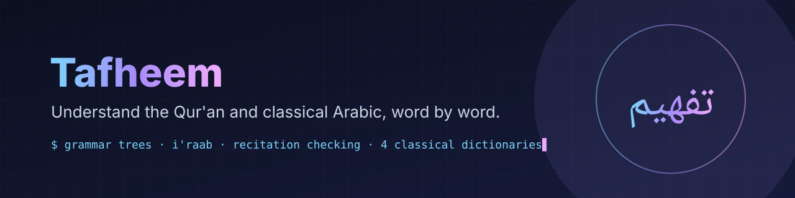

**[Open the app](https://tafheem-app.vercel.app)**

Understand Quranic and classical Arabic, word by word. Grammar, morphology, the Quran and four classical dictionaries in one study app.

Built on real corpora and classical references. AI explanations are optional; the core app runs fully offline.

## What is in it

One row per tab, with the files behind it: `CORE-FLOW.md`. Every HTTP endpoint is listed live on the FastAPI page at `/docs` while the backend runs.

## Stack

| Layer | Tech |
|---|---|
| Frontend | React 19, Vite, Tailwind CSS, TanStack Query |
| Backend | FastAPI, Pydantic, PyArabic |
| Data | Quranic corpus (SQLite), Wiktionary dictionary (JSON), grammar rules |
| AI (optional) | Groq or local Ollama |
| Hosting | Landing page on Vercel, app on an Oracle Cloud VM (see [deploy/](deploy/README.md)) |

## Run and test

Commands to run the app, the tests and the data builds: `CORE-FLOW.md` (Run it) and `docs/core-flow-detail.md`. `./start.sh` is a one-shot launcher for macOS/Linux. Optional: set `GROQ_API_KEY` in `.env` for AI explanations ([free key](https://console.groq.com/keys)).

## Docs

- `CORE-FLOW.md`: what it does, the flow, the glossary
- `docs/core-flow-detail.md`: long notes; `docs/glossary/`: per module
- `RECITE-PLAN.md`: reciting rules and open work
- `docs/strategy/README.md`: product strategy

## Troubleshooting

| Problem | Fix |
|---|---|
| `GROQ_API_KEY not set` | only needed for AI features; add it to `.env` and restart |
| `Ayah not found` | surah is 1 to 114; check the ayah number |
| Empty dictionary | build it: `python backend/scripts/build_dictionary.py` |

## Data and licensing

Uses openly licensed sources only. Hans Wehr is under copyright and is not shipped. Respect the terms of each external resource.
