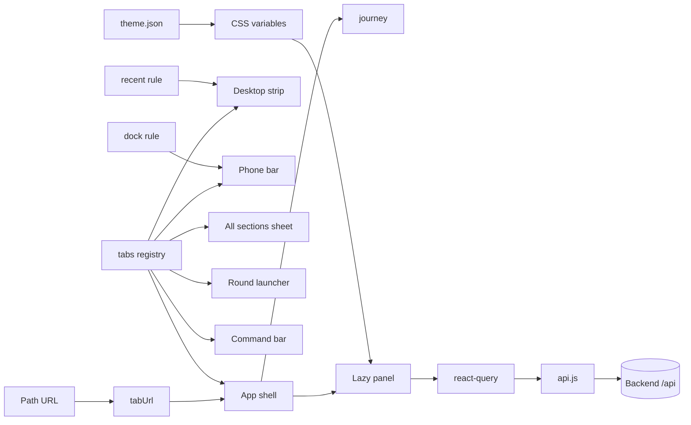

# Frontend architecture

What the app is made of today, and the plan for the four big changes still left
from the frontend review. Paths are relative to `frontend/src`.

## User Flow

open `/app/<tab>/<place>` → `lib/tabUrl.js` reads the path → `App.jsx` shows the tab
→ the registry `lib/tabs.js` lazy-loads that tab's panel → the panel asks for data
through react-query → `api.js` → backend `/api`. Moving to another tab goes through
the same `show()`, and `lib/journey.js` records it for back and forward.

## Core Parts

| Layer | Part | Job |
|---|---|---|
| Entry | `App.jsx` (435 lines) | Shell: header, tab switching, the open/closed state of the four overlays, tools |
| Entry | `lib/tabUrl.js`, `lib/journey.js` | Path URL ↔ tab, back/forward |
| Core | `lib/tabs.js` | One registry: every tab, its label, icon, colour, panel |
| Core | Nav surfaces: `ui/TabStrip`, `ui/BottomNav`, `SectionsMenu`, `SpatialHome`, `CommandBar` | Five ways to move between tabs, all read the registry |
| Core | `lib/recent.js` (desktop strip) and `lib/dock.js` (phone bar) | Which tabs a bar shows. Two different rules for one job |
| Core | Panels: `MemorisePanel` + `memorise/hooks.js`, `QuizPanel` + `QuizBoard` + `lib/useQuizRound.js`, `TarkeebDiagram`, … | The screens |
| Data | `api.js`, `lib/quizBanks.js` | axios client, query keys shared by react-query |
| Config | `theme.json` → `theme.js` → CSS variables; `settings.json` | Colours, Arabic size ladder, motion durations |
| Style | `styles/motion.css` + per-feature CSS | Animations, 52 keyframes |

## Visual Architecture

## Future Architecture & Known Debt

Ranked by risk. Each item ships as its own small PR. Every step leaves the app
working.

| # | Debt | Why it hurts | Plan |
|---|---|---|---|
| 1 | No way to render a screen in a test | Only pure helpers and static markup are tested. Nothing catches a screen that throws on open | Phase A |
| 2 | 52 keyframes, about 20 near copies (fade, rise, pop, pulse) | The same move looks slightly different from place to place, and every copy needs its own reduce-motion care | Phase B |
| 3 | The Tarkeeb chart only scrolls | Long sentences go off the screen; deep trees grow tall | Phase C |
| 4 | `QuizPanel` main function is about 450 lines | Setup, scope, four queries, scoring and 170 lines of markup in one place | Phase D |
| 5 | `MemorisePanel` file is 621 lines | The panel is already thin (state lives in `memorise/hooks.js`), but four sub-components share the file and `hooks.js` (454 lines) has no tests | Phase D |
| 6 | Five ways to move around, and two bar rules | The phone bar is pinned by hand; the desktop strip fills itself | Phase E |

### Phase A: render-test seam

Status: steps 0 and 1 done, and the quiz half of step 2 (`src/test/`). The fake
backend answers static files from `public/`, so the quiz runs on the real word
banks. Still to do: the memorise gap.

0. Walking skeleton: add `happy-dom` + `@testing-library/react` as dev
   dependencies, plus `src/test/render.jsx` (a fresh `QueryClient`, data filled in
   with `setQueryData`, `api.js` mocked). One test renders one small panel.
1. A smoke test per core screen: Quran, Memorise, Quiz, Tarkeeb, Dictionary. Each
   one opens without throwing and shows its main heading or control.
2. One interaction per core flow: answer a quiz question, reveal a memorise gap.

Fitness: `npm test` runs them; a screen that throws on open fails CI.

### Phase B: one set of animations

Status: done for fade and rise. Nine copies are gone (52 → 44 keyframes), each
place now sets only its knobs, and `styles/keyframes.test.js` fails on a new
copy. The pop and pulse groups stay as they are: each one ends somewhere
different (overshoot, ring out, glow), so none of them is a copy.

0. Pick the shared moves in `styles/motion.css`: `fade-in`, `fade-out`, `rise-in`,
   `pop`, `pulse`. Their distance and scale come from CSS variables, so a feature
   changes how far, not which keyframe.
1. Swap the exact copies first (`entry-rise`, `sh-fade`, `grow-fade`, `late-in`,
   `xp-rise`), one file per commit.
2. Then the near copies (`pbs-rise`, `ayah-rise`, `cb-drop`, `grow-popin`,
   `grow-pulse`, `xp-pulse`), with the distance passed as a variable.
3. Fitness test: a vitest that reads every CSS file and fails when a new
   `@keyframes` only animates opacity/translate/scale outside `motion.css`.

One-off moves (mascot, landing art, mic) stay where they are.

### Phase C: Tarkeeb chart fits any screen

Status: done. The chart shrinks as a whole (CSS `zoom`) to fit, floored at
`arabic.chart-fit-min` (0.7), then scrolls. Dots and jumps read word positions
off the screen, so they stay right when shrunk. Rows past the first four fold
behind "▸ N more rows"; book examples (at most 4 rows) never fold, long ayahs
(18:1 has 7) do. The fold state lives in the diagram itself, not in
`useTarkeebView`: only the diagram reads it, and the larger view (`whole`)
always draws every row.

0. Fit to width: `TarkeebDiagram` already measures the scroller through `useRail`.
   When the grid is wider than the scroller, set a per-chart
   `--arabic-chart-rem` scaled down, never below `arabic.small-rem`. Past that
   floor it scrolls as it does today.
1. Fold deep levels: show only the top N rows of names (N in `theme.json`); the
   folded lower rows open from a "▸ more" chip. The open/closed state sits in
   `lib/useTarkeebView.js` next to split/merged and maximise.
2. Unit tests in `tarkeebLayout.test.js` for the fold (levels count from the
   leaves, so "deep" is measured from `levels.length`).

### Phase D: smaller screens (needs Phase A)

0. Quiz: move the setup into `useQuizSetup`: language, direction, bank, scope and
   group, the four queries, then `pool` and `question` derived from them. Move the
   score into `useQuizScore`: the score, best, `onAnswer` and its streaks.
   `QuizPanel` keeps the markup only. Render test first, then move.
1. Pull the `note` nested ternary out into one named function.
2. Memorise: move `SimilarCards`, `Line`, `RecitedWord`, `Gap` into
   `components/memorise/`. No behaviour change.
3. Split `memorise/hooks.js` one file per hook, with tests for `useGaps` and
   `useBookPage` through `renderHook`.

Fitness: no component file over 400 lines; no function over 50 lines in these
screens.

### Phase E: one way to move around (needs Phase A)

0. One bar rule: a single model that both bars read, with fixed tabs first,
   then recent tabs that keep their places, then More. It replaces
   `lib/recent.js` + `lib/dock.js`. Saved data from both old rules still loads.
1. One directory: the All sections sheet becomes the single list of
   everything, with search at its top (the same search logic as the command bar).
2. The round launcher becomes a view of that same directory, or it goes (ADR-1).
3. Map stays: it explains the sciences, it is not navigation.

Fitness: each bar is a thin view over one model; a test checks that every tab is
reachable from the directory.

### ADR-1 (stub): the round launcher

- Status: proposed.
- Choice: keep it as the empty-state home that draws the same directory, or
  remove it and keep only the sheet.
- Lean: keep it as a view, because it is the app's look, but stop it being a
  separate list.

### ADR-2 (stub): one bar rule

- Status: proposed.
- Choice: auto-recent everywhere, or let people pin tabs everywhere.
- Lean: auto-recent with pinning on top. Pinned tabs never move; the rest keep
  their places as recents.
